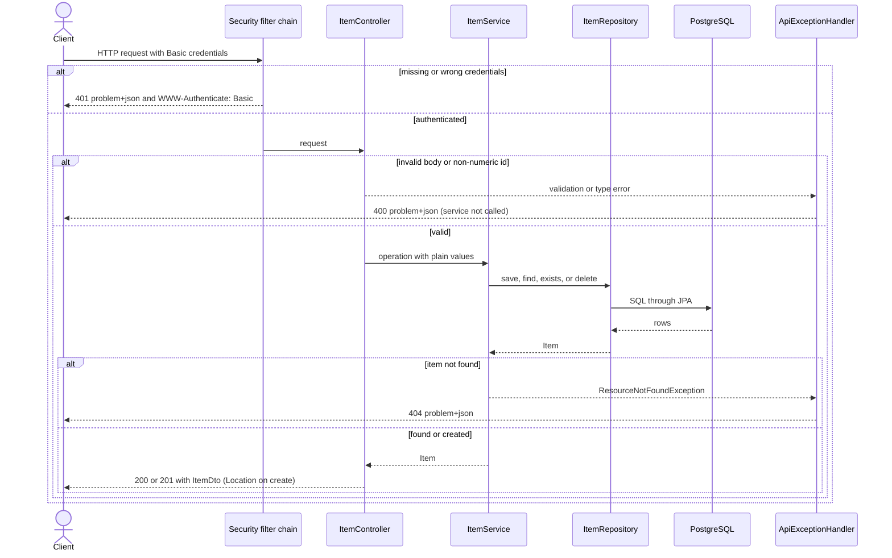
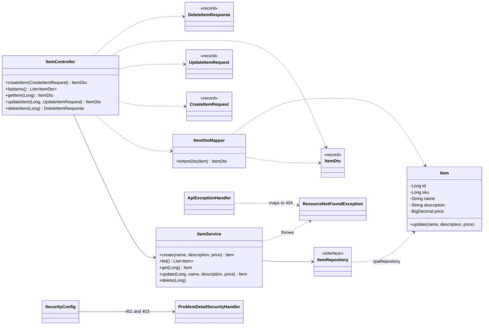
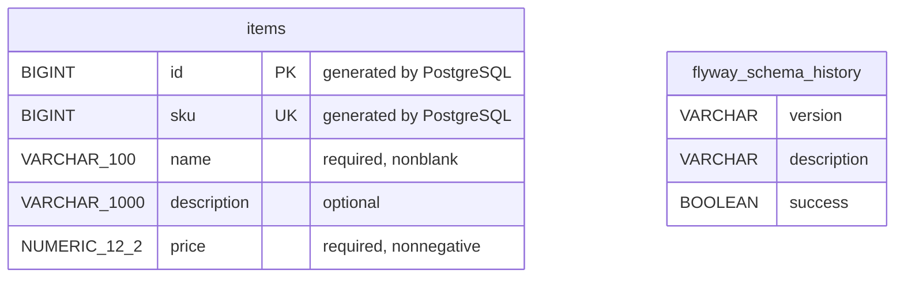

# Spring Boot Template


A Java REST backend starter with Maven Wrapper and a feature-based layered architecture.

**Work in progress.** The project is a single Maven application with item controllers, a service, and Spring Data JPA persistence. It supports item creation, listing, retrieval by ID, update by ID, and deletion by ID, verified against local PostgreSQL. A Spring Security baseline requires HTTP Basic on every path except Actuator health, using one in-memory user from required environment variables. Badge versions reflect the project configuration.


## Quick start

Requirements: JDK 25 available in your terminal. A global Maven installation is not required. The first build may download Maven and dependencies.

Build and tests can run with PostgreSQL stopped and without any credentials. To start the application, first start the external database and complete the local `.env` described in [Database configuration](#database-configuration) and [Security](#security). Run from the repository root:

```bash
java -version
./mvnw clean verify
java -jar target/spring-boot-template-0.0.1-SNAPSHOT.jar --server.address=127.0.0.1
```

The application listens on `http://127.0.0.1:8080`. `--server.address=127.0.0.1` binds it to the local machine only: without it Spring Boot listens on every network interface, so anyone who can reach your machine could call the API, and HTTP Basic sends credentials without encryption (see [Security](#security)). Drop the option only when you deliberately expose the service, behind HTTPS. Stop it with Ctrl+C. On Windows, use `mvnw.cmd` instead of `./mvnw`. No custom startup scripts are required.

## Database configuration

Spring Data JPA with Hibernate, the PostgreSQL runtime driver, the Flyway starter, and Flyway PostgreSQL support are declared in the root `pom.xml`. Versions are managed by the Spring Boot parent.

| Variable | Example value | Purpose |
|---|---|---|
| `DB_URL` | `jdbc:postgresql://<db-host>:<db-port>/<db-name>` | JDBC connection URL |
| `DB_USERNAME` | `<db-user>` | Database user |
| `DB_PASSWORD` | Entered locally | Required password; no default |

Replace all `<...>` placeholders with your environment values. On first setup, copy `.env.example` to `.env` if it does not already exist. Edit your local `.env`:

```properties
DB_URL=jdbc:postgresql://<db-host>:<db-port>/<db-name>
DB_USERNAME=<db-user>
DB_PASSWORD=<db-password>
APP_SECURITY_USERNAME=<api-username>
APP_SECURITY_PASSWORD=<api-password>
```

The application optionally imports `.env` with `spring.config.import`. The root `application.properties` defines datasource and JPA settings; environment variables supply their values. The file uses Java properties syntax, not shell syntax: do not wrap values in quotes or use `export`. Spaces, `$`, and `#` within a value are literal; double literal backslashes and escape leading spaces. If you used the earlier shell-style example, remove its surrounding quotes locally. Keep the local file ignored by Git; commit only `.env.example` with placeholders.

Start the JAR from the repository root so the relative `.env` import resolves there. The Maven Boot plugin is configured to use that same root directory for development startup. For an IDE, set the working directory to the repository root. Injected environment variables take precedence over values from `.env`.

The `TEMPLATE:` comment next to the import marks where derived projects can adapt configuration sources for different environments. The import is optional so deployments can inject environment variables instead; database connection values are still required.

`spring.jpa.hibernate.ddl-auto=none` prevents Hibernate from creating or changing tables. Flyway owns schema changes. `spring.jpa.open-in-view=false` keeps persistence sessions out of web response rendering. The item service uses Spring Data JPA for persistence.

### Schema migrations

Spring Boot runs Flyway at startup before initializing JPA. SQL migrations live in `src/main/resources/db/migration`. `V1__create_items.sql` creates this example schema:

| Column | PostgreSQL type | Rule |
|---|---|---|
| `id` | `BIGINT` | Primary key, generated incrementally by PostgreSQL |
| `sku` | `BIGINT` | Unique, generated incrementally by PostgreSQL |
| `name` | `VARCHAR(100)` | Required, nonblank |
| `description` | `VARCHAR(1000)` | Optional |
| `price` | `NUMERIC(12,2)` | Required, nonnegative, two decimal places |

Both generated numbers start at 1 and use independent sequences. Gaps are possible; SKU is a numeric example code, with no formatting or currency conversion. Use `BigDecimal` when implementing price in Java. HTTP validation rejects unsupported precision before persistence.

Flyway records applied versions and checksums in `flyway_schema_history`. On the next startup it validates the existing migration and applies only pending versions. Once a migration is applied to a database that must be preserved, add a new migration such as `V2__change_items.sql` rather than editing V1. This application owns the schema and its migrations; if another service uses the same database, decide a single owner for migrations or use separate databases or schemas.

Build with `./mvnw verify`, then start the application using either documented startup command. To inspect the result, run these commands from your PostgreSQL environment, replacing the placeholders:

```bash
docker compose exec '<postgres-service>' psql -U '<db-user>' -d '<db-name>' -c '\d items'
docker compose exec '<postgres-service>' psql -U '<db-user>' -d '<db-name>' -c 'SELECT version, description, success FROM flyway_schema_history;'
```

The [Verification history](#verification-history) section summarizes what has been verified live. The sections above describe the current behavior.

### Local PostgreSQL

Run PostgreSQL in an external Docker Compose project (or any PostgreSQL 18 instance) and configure this backend with your own connection values.

JDBC URL format: `jdbc:postgresql://<db-host>:<db-port>/<db-name>`. Connection settings use the environment variables listed above; passwords must be provided locally and never committed or copied into documentation. Every path except the public Actuator health endpoints requires the Basic credentials described in [Security](#security).

Replace the placeholders and run these commands from the external Docker project to start and check the environment:

```bash
docker compose up -d --wait
docker compose ps
docker compose exec '<postgres-service>' psql -U '<db-user>' -d '<db-name>'
```

The database must be reachable from the environment running Java. Starting the external environment does not create application tables; the Flyway migrations in this backend own those changes.

## Security

Spring Security requires authentication for every path except the Actuator health endpoints. A request to any other path without valid credentials receives `401` as `application/problem+json` with the fixed detail "Authentication required" and a `WWW-Authenticate: Basic` challenge, and the item service is never called. An authenticated request denied by an authorization rule would receive `403` with the fixed detail "Access denied"; the baseline defines no roles, so no rule can deny an authenticated request yet. The API is stateless: no HTTP session is created and every authenticated request carries its own credentials. CSRF protection is disabled and CORS is not enabled; both are deliberate baseline decisions explained below.

### Credentials

One in-memory user is built at startup from two required variables. There are no defaults: the application fails to start when either value is missing or blank, and the failure names the missing property. The password is encoded with BCrypt at startup; only the hash is kept in memory, and no generated password is ever logged.

| Variable | Example value | Purpose |
|---|---|---|
| `APP_SECURITY_USERNAME` | `<api-username>` | Username of the single API user |
| `APP_SECURITY_PASSWORD` | Entered locally | Required password; no default |

Supply them the same way as the database variables: in the local ignored `.env` (see the example in [Database configuration](#database-configuration)), or as environment variables, which take precedence over `.env`. This works the same in every tool, because the `.env` import only requires the working directory to be the repository root:

- **Terminal:** run `./mvnw spring-boot:run` or the packaged JAR from the repository root, or `export APP_SECURITY_USERNAME=... APP_SECURITY_PASSWORD=...` before the command.
- **IntelliJ IDEA:** the default working directory is the project root, so `.env` is picked up; alternatively set *Environment variables* in the Run/Debug configuration, or use the EnvFile plugin.
- **VS Code:** run from the integrated terminal with the repository root as cwd, or set `"env"` in the `launch.json` configuration (`"env": {"APP_SECURITY_USERNAME": "...", "APP_SECURITY_PASSWORD": "..."}`).

Never commit real credentials; `.env.example` carries placeholders only.

### Using the API with HTTP Basic

Send the credentials on every request, for example with `curl -u '<api-username>:<api-password>'`. HTTP Basic transmits credentials base64-encoded, which is not encryption: **require HTTPS whenever the credentials cross a network**; plain HTTP is acceptable only for local development against `127.0.0.1`. Basic is the initial mechanism so the template is usable out of the box — it is not a production authentication design.

### Decisions derived projects must revisit

The `TEMPLATE:` comments in `SecurityConfig` mark each decision. Step-by-step recipes for the common changes (roles and `403`, JWT resource server, database users, CSRF for browser clients, CORS, operational endpoints) are in [docs/security-recipes.md](docs/security-recipes.md); they are guidance and unverified.

- **Authentication mechanism:** replace HTTP Basic and the single shared user with what the project needs (per-user credentials, JWT resource server, OAuth2 login). Remove or replace the in-memory user.
- **Authorization and `403`:** add request rules or method security when roles exist; until then `403` is configured but unreachable.
- **CSRF:** disabled because the API is stateless and clients send credentials explicitly per request. **Re-enable it as soon as authentication relies on browser cookies or sessions**, or a browser sends credentials automatically; CSRF protection is then required for state-changing operations.
- **CORS:** not enabled by default. Enable it with `http.cors(...)` plus an explicit `CorsConfigurationSource` bean listing the allowed origins when a browser frontend from another origin must call the API.
- **Security headers:** framework defaults apply; review them for the deployment (for example HSTS behind TLS termination).
- **Secret handling:** keep credentials in the environment or the ignored `.env`; never in code, logs, or committed files.
- **Operational endpoints:** only Actuator health paths are permitted without credentials; all other paths remain authenticated and only `health` is exposed. Review the rules and exposure when adding operational endpoints.

## Operations

Spring Boot Actuator exposes only the `health` endpoint. Liveness and readiness probes are enabled at `/actuator/health/liveness` and `/actuator/health/readiness`; both are available without Basic credentials so a platform can probe the application. Liveness reports whether the process is running. Readiness includes the database health indicator and reports `DOWN` with HTTP `503` while PostgreSQL is unavailable. Health responses show only the overall status: component details, connection information, and exception messages are hidden by `management.endpoint.health.show-details=never`.

The security filter permits `/actuator/health/**` before requiring authentication for all other paths. The only exposed management endpoint is `health`; paths such as `/actuator/env` are not exposed, even to authenticated callers. If a derived project changes the management base path, update the matcher in `SecurityConfig` as well as the probe URLs. Review endpoint exposure, health detail policy, probe groups, and whether management should use a separate port or network policy before deployment.

Logging uses Spring Boot defaults: console output at `INFO`. Derived projects can configure levels and logging destinations for their operations environment. Never log credentials, request secrets, or health component details. Metrics and tracing are not configured; add a collection backend only when the deployment has a concrete monitoring requirement.

Deployment decisions remain open for derived projects: inject the required database and API credentials through the deployment's secret mechanism, decide whether to isolate management traffic on a separate port or network rule, and configure the platform's probe paths and failure thresholds. This template does not provision monitoring or deployment infrastructure.

## Current API

| Method | Path | Request | Current response |
|---|---|---|---|
| POST | `/api/v1/items` | JSON with `name`, optional `description`, and `price` | `201 Created`, JSON and `Location` |
| GET | `/api/v1/items` | None | `200 OK`, JSON array sorted by price ascending, then ID |
| GET | `/api/v1/items/{id}` | Numeric `id` path segment | `200 OK` with the item as JSON; `404` if it does not exist; `400` if `id` is not a number |
| PUT | `/api/v1/items/{id}` | Numeric `id` path segment and JSON with `name`, optional `description`, and `price` | `200 OK` with the updated item as JSON; `404` if it does not exist; `400` for an invalid or malformed body or a non-numeric `id`; `415` for other content types |
| DELETE | `/api/v1/items/{id}` | Numeric `id` path segment | `200 OK` with a JSON confirmation containing only the deleted `id`; `404` if it does not exist; `400` if `id` is not a number |

Every operation also requires valid credentials: without them the response is `401` `application/problem+json` (see [Security](#security)). With the application running, open another terminal:

```bash
curl -i -u '<api-username>:<api-password>' -X POST http://127.0.0.1:8080/api/v1/items \
  -H 'Content-Type: application/json' \
  -d '{"name":"Notebook","description":"Example item","price":12.50}'
```

Example response (identifiers depend on the database):

```http
HTTP/1.1 201 Created
Location: http://127.0.0.1:8080/api/v1/items/1
Content-Type: application/json

{"id":1,"sku":1,"name":"Notebook","description":"Example item","price":12.50}
```

The controller passes `CreateItemRequest` values to the service and returns `ItemDto`. `Location` identifies the created item resource, which `GET /api/v1/items/{id}` returns. The `PUT` handler passes `UpdateItemRequest` values to the service and returns the updated `ItemDto`. `PUT` fully replaces `name`, `description`, and `price`: a body without `description` clears it. `id` and `sku` keep their generated values. The `DELETE` handler removes the item through the service and returns `200` with `DeleteItemResponse`, a confirmation body containing only the deleted `id`.

### Input validation and errors

`spring-boot-starter-validation` supplies Bean Validation. The request records strip leading and trailing whitespace from `name` before validation. `@Valid` on the controller parameter checks:

- `name`: required, nonblank, at most 100 characters after stripping; internal spaces are preserved.
- `description`: optional (missing or null), at most 1000 characters; unchanged, including spaces.
- `price`: required `BigDecimal`, nonnegative, at most 10 integer digits and 2 decimal places. Excess decimal places are rejected rather than rounded. Zero is valid; no currency is assumed.

`id` and `sku` are generated by PostgreSQL when persistence is connected; they are not request fields.

Invalid fields, malformed JSON, incompatible field types, and missing bodies return `400` with `application/problem+json`. `ApiExceptionHandler` extends Spring's `ResponseEntityExceptionHandler`; validation failures include an `errors` array with field names and messages. Rejected values and exception details are not exposed. MVC errors such as unsupported content also use Problem Details with their own status codes.

Example for a negative price:

```json
{
  "type": "about:blank",
  "title": "Bad Request",
  "status": 400,
  "detail": "Request validation failed",
  "instance": "/api/v1/items",
  "errors": [{"field": "price", "message": "Price must be nonnegative"}]
}
```

Invalid requests return `400` without invoking the service. Valid requests create an item and return `201`.

When no item has the requested ID, `GET /api/v1/items/{id}`, `PUT /api/v1/items/{id}`, or `DELETE /api/v1/items/{id}` returns `404` with `application/problem+json` and the fixed detail "Item not found". A repeated `DELETE` therefore reports `404` instead of silently accepting the request. The service throws `ResourceNotFoundException(resource, id)`, a generic exception in the `exception` package that other features can reuse; `ApiExceptionHandler` maps it to `404` using only the resource name. A non-numeric `id` returns `400` with Problem Details from Spring's default handling, without invoking the service. Update requests are validated with the same rules as creation; invalid ones return `400` without calling the service and leave the stored item unchanged.

### HTTP status conventions

| Operation | Success | Expected errors |
|---|---|---|
| `POST /api/v1/items` | `201` JSON with `Location` | `400` invalid, malformed, or missing body; `415` non-JSON content type |
| `GET /api/v1/items` | `200` JSON array | None in the example |
| `GET /api/v1/items/{id}` | `200` JSON item | `400` non-numeric `id`; `404` if it does not exist |
| `PUT /api/v1/items/{id}` | `200` updated JSON item | `400` invalid, malformed, or missing body or non-numeric `id`; `404` if it does not exist; `415` non-JSON content type |
| `DELETE /api/v1/items/{id}` | `200` JSON with only the deleted `id` | `400` non-numeric `id`; `404` if it does not exist |

For any operation, an unexpected exception is mapped by the catch-all `Exception` handler in `ApiExceptionHandler` to `500` with `application/problem+json` and the fixed detail "Unexpected error". The exception is logged on the server at error level with its stack trace; the response never contains the exception message or type, the stack trace, or request values. More specific handlers win, so the statuses above are unaffected. Problem Details is the single error format for every error this API produces — including the security rejections (`401`/`403`), which are written by the security filter chain before MVC and described in [Security](#security).

Known limitations: there is no `409 Conflict` mapping because the example generates `id` and `sku` in PostgreSQL and has no client-supplied unique value that could conflict; document the mapping when a derived feature introduces one. The list endpoint has no pagination or sorting parameters yet; adding them is planned and needs compatibility decisions.

### Item service

`ItemService` creates items, lists them ordered by price and ID, gets one by ID (read-only transaction, throwing `ResourceNotFoundException` when absent), updates one by ID (read-write transaction: load the item or throw `ResourceNotFoundException`, replace its fields through `Item.update`, and return the saved entity), and deletes one by ID (read-write transaction: `existsById` check, throwing `ResourceNotFoundException` when absent, then `deleteById`; the confirmation body echoes the validated ID, so no entity is loaded). It defines transaction boundaries and uses the Spring Data JPA repository. The entity validates creation and update values with one shared check; PostgreSQL generates the identifiers. The service returns entities to the HTTP layer, which maps them to response DTOs.

## Project structure and architecture

The application is built as a single Maven JAR and organized by feature. The `items` feature is split into `controller`, `service`, `repository`, `entity`, and `dto` subpackages; application-wide HTTP error handling, including the shared `ResourceNotFoundException`, lives in the `exception` package; and application-wide security configuration lives in the `security` package. The conventions below describe this structure. External-service clients can be added when an integration requires them. Interfaces and separate domain models should address concrete needs rather than be mandatory for every feature.

### Repository layout

```text
.
|-- src/main/java/com/example/template/   Application code (see the package tree below)
|-- src/main/resources/
|   |-- application.properties            Datasource, JPA, and security configuration (TEMPLATE: comments)
|   `-- db/migration/                     Flyway SQL migrations (V1__create_items.sql)
|-- src/test/java/com/example/template/   Automated tests, mirroring the main packages
|-- docs/                                 Guides: adapting the template, security recipes
|-- openspec/                             OpenSpec workflow: specs/ (current behavior contracts), changes/ (proposed and archived changes), config.yaml
|-- .github/workflows/ci.yml              GitHub Actions: ./mvnw --batch-mode verify
|-- .claude/, .agents/, .opencode/        Assistant tooling: agents, commands, skills, and hooks for the OpenSpec workflow
|-- .mvn/wrapper/, mvnw, mvnw.cmd         Maven Wrapper (no global Maven needed)
|-- pom.xml                               Maven build and dependencies
|-- .env.example                          Placeholders for the local, ignored environment file
|-- AGENTS.md                             Rules for AI agents working in the repository
`-- README.md, LICENSE                    This document and the MIT license
```

The local environment file with your own values and the `target/` build output are not tracked. A derived project typically deletes `openspec/` and may remove the assistant tooling folders; see the [adaptation checklist](docs/adapting-the-template.md).

### Diagrams

**Request flow.** Every request first passes the security filter chain; the rest depends on the outcome. Rejections are Problem Details, as is every error the API produces.



**Classes.** Dependencies point from the caller to the callee. The controller maps entities to DTOs; the service never sees HTTP types.



**Tables.** The example schema has one application table. Flyway keeps its own history table.



`flyway_schema_history` lists only the columns queried in this document. The two tables are not related.

### Architecture conventions

The template is designed to grow, so each feature uses this structure from the start. These are community conventions rather than official Spring guidance: package by feature is the mainstream choice for applications that grow, and layers inside each feature are a common hybrid, although some guides suggest starting with a flat feature package.

```text
com.example.template
|-- SpringBootTemplateApplication
|-- exception/            ApiExceptionHandler, ResourceNotFoundException
|-- security/             SecurityConfig, ProblemDetailSecurityHandler
`-- items/                one package per feature
    |-- controller/       ItemController
    |-- service/          ItemService
    |-- repository/       ItemRepository
    |-- entity/           Item
    `-- dto/              ItemDto, CreateItemRequest, UpdateItemRequest, DeleteItemResponse, ItemDtoMapper
```

- **Packages:** a feature owns its layers as subpackages. Never create an empty package. A feature does not import another feature's DTOs or entities; it goes through that feature's service, which avoids circular dependencies.
- **Naming and visibility:** entities and repositories carry no `Jpa` suffix (`Item`, `ItemRepository`), because there is no separate domain model and the package already identifies the layer. Classes are `public` because the layers live in different packages.
- **Controllers:** one controller per resource, with the base path on the class (`@RequestMapping`) and one method per operation. Its tests live in one class with a `@Nested` group per operation.
- **Errors:** application-wide error handling and shared exceptions live in the `exception` package. Services throw the shared `ResourceNotFoundException(resource, id)`, and `ApiExceptionHandler` maps it to `404` with the fixed detail "<resource> not found". Do not create one not-found exception per entity.
- **Security:** application-wide security configuration lives in the `security` package (`SecurityConfig` owns the filter chain, the password encoder, and the in-memory user; `ProblemDetailSecurityHandler` writes the `401`/`403` Problem Details). Security rejections happen in the filter chain, before MVC, so `ApiExceptionHandler` never sees them. Derived projects adapt it following the `TEMPLATE:` comments and the [Security](#security) section.
- **DTOs:** a feature owns the DTOs it exposes. A request DTO is specific to an operation; a response DTO can be shared within the feature. A response from an external service gets its own representation, mapped to the internal or public DTO.
- **Transactions:** declared on service methods (`@Transactional`, with `readOnly = true` for reads), never on controllers.
- **Validation:** Bean Validation on the request DTO produces the `400` with field errors. The entity guards its invariants in the constructor and in `update`, so a failure there indicates a bug rather than a client error.

### External service clients

Introduce a client only when a real integration requires it, and never create the package before the client exists (no-empty-packages rule). **This guidance is unverified:** no integration uses it yet, so review it against the concrete case when the first client is added.

- **Placement:** a client used by one feature lives in that feature (`<feature>/client/`) with its own response DTOs, called by that feature's service. When several features need the same service, create a package named after the external service (for example `payments/`) with its own client, DTOs, and service-level entry point, and treat it as a feature under the cross-feature rule: others use it through its service, never through its DTOs or entities.
- **Configuration:** the service address, credentials, and timeouts are externalized properties supplied through environment variables and never committed, following the same `.env` and `TEMPLATE:` conventions as the datasource. The HTTP client library (`RestClient`, `WebClient`, declarative clients) is a `TEMPLATE:` decision left to the first real integration.
- **Error translation:** client failures are translated into a domain-level exception in the `exception` package, one per failure category (unavailable, timeout, unexpected response), and mapped by `ApiExceptionHandler` to Problem Details with fixed generic details (`502` and `504` are typical). Upstream response bodies are never exposed.
- **Mapping:** the external response DTO is mapped to the internal or public DTO at the boundary, as the DTO convention above already states.
- **Tests:** use controlled responses: stub the client bean in service and `@WebMvcTest`-style tests, or use a mock HTTP server. Automated tests never make real network calls and require no external service.
- **Resilience:** retries, idempotency, authentication, observability, and circuit breaking are decided per real integration and are not added by default.

Security is documented in the [Security](#security) section; external-service configuration follows the conventions above.

Sources and tests live in `src/main/java` and `src/test/java`. Configuration and Flyway migrations live in `src/main/resources`. Keep source and documentation in English.

## Development and verification

Use this command from the repository root to verify the application:

```bash
./mvnw verify
```

Use `./mvnw clean verify` for a clean build. What the automated tests cover, what stays manual, and the persistence checklist are documented in one place: the "Testing strategy" section below. As behavior is added, automate business-rule tests with repository mocks or test doubles and HTTP tests with mocked services; automated tests must not require PostgreSQL or Testcontainers.

For development, complete the local `.env`, then run these commands from the repository root. Keep `--server.address=127.0.0.1` for local runs so the API is not reachable from other machines:

```bash
./mvnw spring-boot:run -Dspring-boot.run.arguments=--server.address=127.0.0.1
```

For a packaged run, build with `./mvnw verify`, complete the local `.env`, and execute from the repository root:

```bash
java -jar target/spring-boot-template-0.0.1-SNAPSHOT.jar --server.address=127.0.0.1
```

The JAR is produced by `./mvnw verify`; it does not require a prior local Maven installation of parent/core artifacts. Spring Boot loads `.env` directly; no custom launcher is needed.

For each change, verify the new behavior and preserve existing contracts. Update this documentation when routes, commands, or file locations change.

## Testing strategy

This section is the single reference for what is tested automatically and what remains manual. The policy: automated tests never require PostgreSQL, Testcontainers, Docker, the network, or real credentials — they run on any machine, including CI, and security tests supply their own dummy values inline. Persistence is verified manually against the external local PostgreSQL, and each persistence-affecting change records its result in "Verification history".

### Automated coverage

| Test class | Mechanism | Covers |
|---|---|---|
| `ItemControllerTests` | `@WebMvcTest` with the real `SecurityConfig` imported, service mocked, dummy credentials inline | The HTTP contract of all five operations under authentication (as a mock user): create (`201` + `Location`, invalid fields with `errors` array, malformed/incompatible/missing body `400`, `415`, price and length boundaries); get by ID (`200`, `404` problem, `400` non-numeric without service call); update (full replacement `200`, omitted `description` clears it, same `400`/`404`/`415` cases); delete (`200` body containing only the `id`, `404`, `400` non-numeric); unexpected failure (generic `500` Problem Detail without leaking the exception message or type, and the error-level log with stack trace); listing (sorted array, empty array); unmapped root `404`. Security behavior: every operation and the root without credentials return `401` `application/problem+json` with the Basic challenge and never call the service; HTTP Basic with the configured user succeeds, and a wrong password or unknown username returns `401`. Operational access: health paths bypass the `401` filter response, while `/actuator/env` and item paths remain `401` Problem Details. 57 tests |
| `ItemServiceTests` | JUnit + mocked `ItemRepository` | Service coordination and business rules: create normalization and the shared invalid-values table; update replaces fields and returns the saved entity, missing ID throws `ResourceNotFoundException` and saves nothing; delete checks `existsById` then `deleteById` and deletes nothing when absent; list sorts by price then ID; get loads by ID or throws. 24 tests |
| `ItemTests` | Plain JUnit, no Spring | Entity invariants: `Item.update` replaces fields and strips the name; invalid values are rejected and the previous state is kept. 2 tests |
| `CreateItemRequestTests`, `UpdateItemRequestTests` | Plain JUnit | Request record normalization: name stripping preserves internal spaces, leaves `description` unchanged, and keeps a missing name for validation. 4 tests |
| `SecurityConfigTests` | Plain JUnit, no Spring | Required-credentials fail-fast: a missing, empty, or blank username or password throws during bean creation with a message naming the property; a valid configuration stores the password as a BCrypt hash instead of the plain value, with no authorities; an unknown username is not found. 10 tests |
| `ProblemDetailSecurityHandlerTests` | Plain JUnit + Spring mock web objects | The security rejection bodies: `401` Problem Details with the fixed detail "Authentication required" and the `WWW-Authenticate: Basic` challenge, `403` Problem Details with "Access denied" and no challenge, without echoing the exception. 2 tests |

All of them run inside `./mvnw clean verify` (99 tests at the time of writing) and none starts persistence. Known limitation: length and price acceptance boundaries are exercised through the create operation only; update reuses the same Bean Validation constraints (`UpdateItemRequest` mirrors `CreateItemRequest`), so its rejection cases are covered but its acceptance boundaries rely on that symmetry. The web slice does not load Actuator, so it cannot verify that live health bodies contain only the overall status, that readiness reflects PostgreSQL availability, or that readiness changes to `503` while the database is unavailable; those behaviors are verified manually.

### What stays manual

Mock-based tests cannot prove the actual persistence integration, health response redaction, database-backed readiness, the readiness `503` transition, or that startup fails before opening a port when required environment variables are missing. Verified only by hand against the external local PostgreSQL, with results recorded in "Verification history": Flyway migration application and `flyway_schema_history`, JPA mappings and database constraints (`NOT NULL`, unique `sku`, `NUMERIC(12,2)`), real create/read/update/delete persistence through authenticated HTTP, durability across restarts, health bodies without details, readiness behavior while PostgreSQL is available or unavailable, startup failure without the `APP_SECURITY_*` values, and the live `401`/authenticated responses. Prerequisites: the external PostgreSQL running, a local `.env` with `DB_URL`, `DB_USERNAME`, `DB_PASSWORD`, `APP_SECURITY_USERNAME`, and `APP_SECURITY_PASSWORD`, and the application started from the repository root.

### Manual persistence checklist

Reproducible steps against the local environment. They create their own sample rows and stay non-destructive. Every API request in these steps carries the configured Basic credentials (`curl -u '<api-username>:<api-password>'`):

1. **Migrations.** Start the application once, then inspect `flyway_schema_history` (`SELECT version, description, success FROM flyway_schema_history;`): V1 applied and successful; a second start reports no pending migration.
2. **Create/read/update/delete round trip.** `POST` a sample (expect `201` + `Location`); `GET` the `Location` (same item); `PUT` a replacement and `GET` again (new values, same `id` and `sku`); `PUT` without `description` (it becomes `null`); `DELETE` (`200` with only the `id`); `GET` again (`404`); repeat `DELETE` (`404`).
3. **Constraints.** Attempt server-level violations through the API (blank name, over-length strings, negative or over-precise price): each returns `400` before persistence. The schema constraints themselves are owned by the Flyway migration and reviewed by reading it (`\d items` in psql).
4. **Restart durability.** Keep one sample row, restart the PostgreSQL container, start the application, and `GET` the row again: it must still return `200`.
5. **Security.** Without the `APP_SECURITY_*` values the application fails to start naming the missing property; with them, an unauthenticated request returns `401` `application/problem+json` with the Basic challenge, and a wrong password also returns `401`.
6. **Cleanup.** Delete the samples you created for steps 2–4 unless they are deliberate verification records.

Rule: a shared development database must never be used as a disposable test database. If other projects share it, anything destructive — dropping schemas, truncating, concurrent resets — belongs in a separate database you own.

### Isolated integration tests (for derived projects)

The template ships none. A derived project that wants automated database tests should keep `./mvnw verify` fast and dependency-free: add Testcontainers (or a dedicated profile) as a separate opt-in, run the classes under a different name that Surefire excludes by default (for example `*IT` bound to Failsafe, or `*IntegrationTests` gated by an active profile), point them at their own throwaway schema, and make them clean up after themselves. Advice only — nothing here is implemented in the template.

## Continuous integration

GitHub Actions runs the standard verification on every push to `development` and on every pull request. **This is intentional: CI does not run on pushes to `main`.** Do not add `main` to the workflow triggers; changes reach `main` only after passing CI on `development` or on a pull request. The workflow is `.github/workflows/ci.yml`: it checks out the repository, sets up Eclipse Temurin JDK 25 with Maven dependency caching, and executes `./mvnw --batch-mode verify` with `contents: read` permissions only.

CI needs no prerequisites: there are no secrets, environment variables, database, or `.env` file. The automated tests use `@WebMvcTest` and mocks, supply their own dummy security credentials inline, and never start the application or connect to PostgreSQL, so CI runs exactly what developers run locally.

Known limitation: a local build does not prove the workflow itself; check the Actions tab after the first push or pull request.

Formatting checks, static analysis, and dependency vulnerability scanning are deliberately deferred: each adds configuration to maintain and opinions for derived projects without solving a current need. Add them individually when a derived project needs them.

## Verification history

Summary of what has been verified live against a local PostgreSQL 18 while the example feature was built. The per-run notes of each step remain in the git history of this file. Add a dated entry here when you verify a persistence-affecting change in your own project.

- **Schema and startup:** Flyway applies `V1__create_items.sql`, a second start reports nothing pending, and JPA connects.
- **Item operations:** create, list, get, update, and delete round-trip through HTTP with persistence, including the `400`, `404`, and `415` Problem Details responses, full replacement on update, and physical delete.
- **Durability:** a sample row survived a PostgreSQL container restart (checked at SQL level; HTTP retrieval after a restart has not been rechecked).
- **Security:** startup fails naming the missing property when the API credentials are absent; requests without credentials return `401` `application/problem+json` with the Basic challenge; an authenticated round trip succeeds; no generated password appears in the log.
- **Health:** unauthenticated liveness and readiness return `200` with only the status; other management paths are not exposed; readiness returns `503` while PostgreSQL is down (after the connection timeout, about 30 seconds) and recovers to `200` without restarting the application.

Last full check: 2026-11-07, `./mvnw clean verify` passed 99 tests without a database.

## Planned work

Follow-up decisions that are not part of the template yet:

1. Roles and authorization rules, which would make the configured `403` response reachable (see [docs/security-recipes.md](docs/security-recipes.md)).
2. Pagination and sorting parameters for the list endpoint, which need compatibility decisions.

## Contributing and agents

Read [AGENTS.md](AGENTS.md) before implementing changes. Keep it concise and use this README as the reference for commands, architecture, and functional status. When adapting the template to start a derived project, follow the [adaptation checklist](docs/adapting-the-template.md).

## License

This project is distributed under the MIT License. See [LICENSE](LICENSE).
